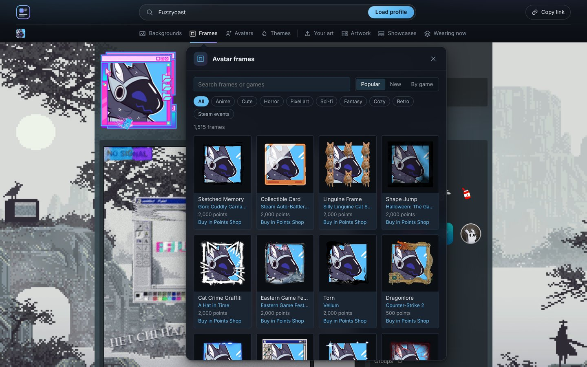
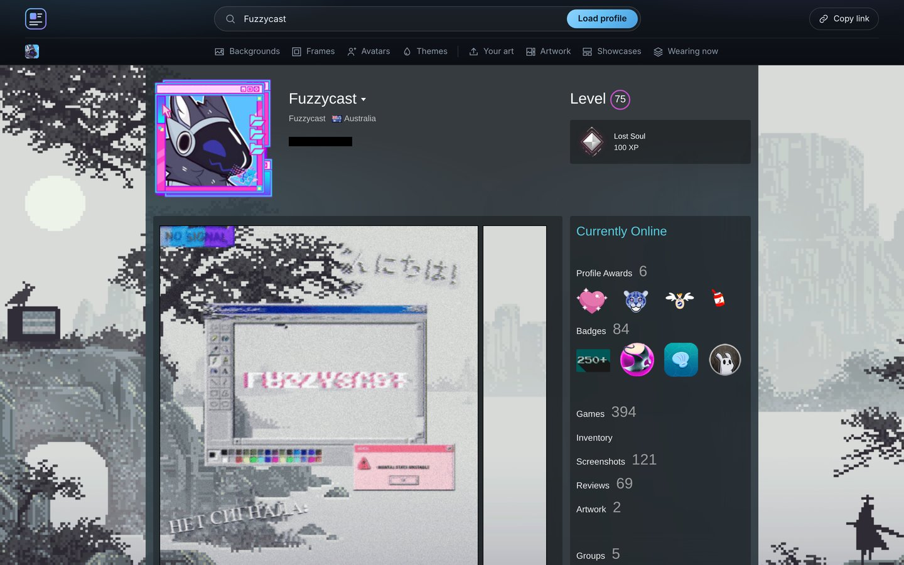

# Steam Profile Studio

**[steam-profile-studio.vercel.app](https://steam-profile-studio.vercel.app)**

Try Steam Points Shop items on any public Steam profile before you spend your points. Paste a profile and it's drawn the way Steam draws it, then click backgrounds, avatar frames, animated avatars and themes to see them on. Every item links to its page in the Points Shop.



## What you can do

- **Try on Points Shop items.** Browse by Popular, New or by game, filter by vibe (Anime, Cute, Horror, Pixel art and more), and see each one on the profile straight away. Your own games come first in "By game".
- **Preview your own art** in the Artwork showcase over your background, or as your avatar. It stays in your browser and is never uploaded.
- **Make artwork that lines up with your background.** Pick the Artwork showcase layout and download a zip with the background pieces cut to the exact slot sizes, a guide image, a layered PSD template and upload steps. Drop your finished art back in to check it before uploading to Steam.
- **Rearrange showcases** to plan a new layout.
- **Share a link.** The profile you're viewing is in the page address.



## How to use it

1. Paste a Steam profile link (`steamcommunity.com/id/…` or `/profiles/…`), a custom URL name or a 17-digit SteamID into the box at the top.
2. Open Backgrounds, Frames, Avatars or Themes in the toolbar and click an item to try it on.
3. Click **Buy in Points Shop** on an item you like. Steam has no link to a single item, so it opens that game's Points Shop page, where you can pick it.

The profile has to be public for its level, items and showcases to show. A private profile shows only its name and avatar, because that's all Steam shares.

## Running it yourself

Requires Node.js 20.9 or newer and a [Steam Web API key](https://steamcommunity.com/dev/apikey).

```bash
npm install
cp .env.example .env.local   # then put your Steam Web API key in .env.local
npm run dev                  # http://localhost:3000
```

`STEAM_API_KEY` is only read by server code and never sent to the browser. Never give it a `NEXT_PUBLIC_` prefix. `.env.local` is gitignored.

| Command | What it does |
|---|---|
| `npm run dev` | Development server |
| `npm run build` | Production build |
| `npm run start` | Serve the production build |
| `npm run lint` | ESLint |
| `npm test` | Unit tests (Vitest) |

Built with Next.js (App Router) and TypeScript, styled with CSS Modules, and deployed on Vercel. Steam responses are cached on the server and Vercel's CDN to stay well inside Steam's rate limits. Project notes and decisions are in [`CLAUDE.md`](CLAUDE.md), and the captured Steam data the layout was measured against is in [`reference/`](reference/).

## Licence

The code is under the [MIT licence](LICENSE).

## Not affiliated with Valve

Steam Profile Studio is a fan-made tool. It is not affiliated with, endorsed or sponsored by Valve Corporation. Steam, the Steam logo and Points Shop item artwork are trademarks or copyrighted material of Valve Corporation and their respective owners, and are shown only to preview them. Item images are loaded from Steam's servers, not hosted here.
